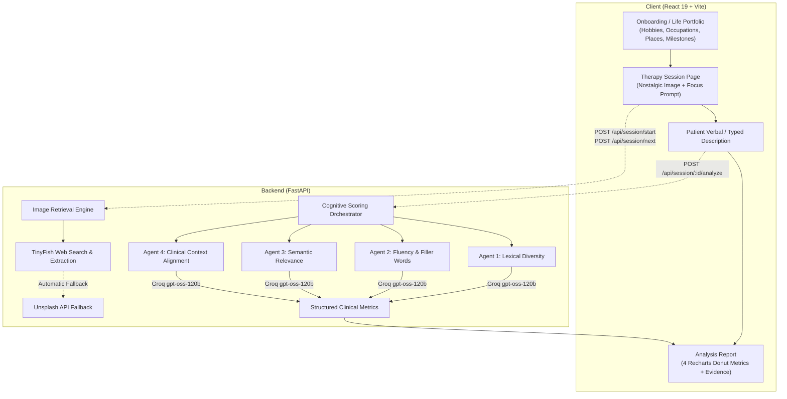

# Sereenify — Cognitive Care & Reminiscence Therapy Platform

**Sereenify** is an AI-assisted cognitive care and reminiscence therapy application designed to support individuals with Alzheimer's disease, dementia, and cognitive decline. By pairing personalized life-history anchors with real-world nostalgic imagery, Sereenify stimulates autobiographical recall and performs real-time, non-invasive linguistic and cognitive speech analysis.

---

## Architecture Overview



---

## 1. Image Retrieval Engine: Powered by TinyFish

Sereenify dynamically sources vintage and archival photographs tailored directly to each patient's personalized life portfolio (hobbies, past careers, childhood hometowns, and life milestones).

### How TinyFish Drives Image Retrieval
Unlike traditional static image repositories, Sereenify leverages **TinyFish** as its primary image-search and web-extraction agent:

1. **Portfolio-Driven Query Formulation:**
   * When a patient starts or progresses through a session, the backend extracts the specific portfolio anchor for that stage (e.g., `"Cooking traditional sweets"`, `"School Teacher"`, or `"Shimla"`).
   * A targeted photographic search query is generated (e.g., `"Cooking traditional sweets vintage photo"` or `"school teacher vintage photo"`).

2. **Web Discovery via TinyFish Search API (`api.search.tinyfish.ai`):**
   * The query is submitted to TinyFish with custom intent filters (`domain_type="web"`).
   * Excludes social networks and gated paywalled sites (`pinterest.com`, `quora.com`, `facebook.com`, `stock.adobe.com`) to prioritize open historical blogs, vintage photo collections, and cultural archives.

3. **Asset Discovery via TinyFish Fetch API (`api.fetch.tinyfish.ai`):**
   * TinyFish fetches the candidate webpages using `"image_links": true`.
   * TinyFish extracts all discovered direct `` src URLs from the live DOM, returning clean structured lists of candidate image links.

4. **Sanitization and Pre-Flight HTTP Validation:**
   * **Pattern Filtering:** Discards UI icons, tracking pixels, SVGs, spacer GIFs, and user avatars using regex filters.
   * **Live HTTP Verification:** Performs fast asynchronous `HEAD` or Range requests (`bytes=0-2048`) to verify:
     * HTTP status `200` or `206`.
     * Valid image MIME type (`image/jpeg`, `image/png`, `image/webp`).
     * Content size $\ge 8\text{ KB}$ to prevent displaying low-resolution thumbnails or tracking beacons.

5. **Display & Source Attribution:**
   * Validated direct image URLs are sent to the frontend alongside proper photographer and archive attribution links.

> **Fallback Mechanism:** As an automated fallback, if TinyFish encounters anti-scraping restrictions, thumbnail-only images, or timeouts on a given target, the system seamlessly retrieves an image from Unsplash (and finally a local offline archive) so therapy sessions are never interrupted.

---

## 2. Multi-Agent Cognitive Scoring Pipeline

When a patient responds to a photograph, their response is evaluated by a specialized multi-agent cognitive assessment system powered by **Groq** (`openai/gpt-oss-120b`):

### The 4 Specialized Clinical Agents

```
                        ┌─────────────────────────────────────────────────────────┐
                        │              Patient Image Description                  │
                        └──────────────────────────┬──────────────────────────────┘
                                                   │
         ┌───────────────────┬─────────────────────┼─────────────────────┬───────────────────┐
         ▼                   ▼                     ▼                     ▼                   ▼
┌─────────────────┐ ┌─────────────────┐ ┌─────────────────────┐ ┌─────────────────┐ ┌─────────────────┐
│ Lexical Agent   │ │ Filler Agent    │ │   Semantic Agent    │ │ Clinical Agent  │ │ Research Distill│
│ Content Density │ │ Hesitations     │ │ Thematic Relevance  │ │ NIA/NIH Markers │ │ Published Evid. │
│ Word Diversity  │ │ Discourse Marks │ │ Memory Proximity    │ │ Context Clues   │ │ PubMed Baseline │
└────────┬────────┘ └────────┬────────┘ └──────────┬──────────┘ └────────┬────────┘ └────────┬────────┘
         │                   │                     │                     │                   │
         └───────────────────┴─────────────────────┼─────────────────────┴───────────────────┘
                                                   ▼
                                 ┌───────────────────────────────────┐
                                 │   4 Interactive Donut Charts &    │
                                 │   Clinician Evidence Disclosures  │
                                 └───────────────────────────────────┘
```

1. **Lexical Diversity Agent:**
   * Calculates Type-Token Ratio (TTR), unique-to-total content word density, and vocabulary richness.
   * Highlights signs of repetitive vocabulary or high-frequency generic word substitution.

2. **Fluency & Filler-Word Frequency Agent:**
   * Detects pauses, hesitations, repetitive discourse markers (*"um"*, *"uh"*, *"you know"*, *"like"*).
   * Evaluates verbal fluency and formulation effort.

3. **Semantic & Thematic Relevance Agent:**
   * Measures contextual alignment between the patient's recollection and the visual anchor.
   * Identifies tangential speech, circumlocution, and topic drift.

4. **Dementia Contextual Alignment Agent:**
   * Correlates patient language patterns with clinical speech indicators synthesized from peer-reviewed dementia and Alzheimer's literature (NIH, NIA, Alzheimer's Association).
   * Provides evidence quotes and confidence scores while displaying explicit non-diagnostic medical disclaimers.

### Optimization Highlights
* **High Speed & Low Token Consumption:** Operates at low reasoning effort with concise JSON schemas, completing all 4 evaluations in **under 5 seconds** and consuming **<1,000 completion tokens** total.
* **Resilient Caching:** Fast memory caching prevents redundant evaluations, while runtime brief updates use `/tmp` on serverless environments.

---

## 3. Technology Stack

### Frontend Client
* **Framework:** React 19, Vite 8, Tailwind CSS v4
* **Routing:** React Router v7
* **Data Visualization:** Recharts (Interactive Donut charts, custom tooltips)
* **Icons & UI:** Lucide React, Custom accessible contrast ratios, Fluid typography

### Backend Engine
* **Framework:** FastAPI, Uvicorn, Python 3.12
* **AI & Agent Orchestration:** Groq SDK (`openai/gpt-oss-120b`), LangChain
* **Web Search Agent:** TinyFish Search & Fetch APIs (`api.search.tinyfish.ai`, `api.fetch.tinyfish.ai`)
* **Validation & Networking:** HTTPX (async HTTP/2 client), Pydantic v2

---

## 4. Project Structure

```
serenify2/
├── README.md                      # Primary project documentation
├── backend/
│   ├── api/
│   │   └── index.py               # Vercel serverless entry point
│   ├── data/
│   │   └── research_seed.json     # Built-in clinical research baseline
│   ├── scoring/                   # Multi-agent scoring pipeline
│   │   ├── agents.py              # 4 Groq scoring agents
│   │   ├── config.py              # Environment & cache configurations
│   │   ├── groq_client.py         # Async Groq client with bounded retry
│   │   ├── orchestrator.py        # Concurrent scoring orchestrator
│   │   ├── prompts.py             # Concise clinical prompt definitions
│   │   ├── research.py            # Clinical research crawler & distiller
│   │   ├── routes.py              # Scoring & research API endpoints
│   │   ├── schemas.py             # Strict Pydantic JSON schemas
│   │   └── tinyfish_client.py     # TinyFish REST API client
│   ├── image_search.py            # TinyFish image search, extraction & validation
│   ├── main.py                    # FastAPI application, session engine & CORS
│   ├── pyproject.toml             # Python dependencies
│   ├── requirements.txt           # Vercel serverless requirements
│   └── vercel.json                # Backend Vercel serverless config
├── frontend/
│   ├── src/
│   │   ├── components/            # Reusable UI & PageShell
│   │   │   ├── common/            # Button, Card, Navbar, Footer
│   │   │   └── session/
│   │   │       └── AnalysisReport.jsx # 4 Donut charts & evidence view
│   │   ├── context/
│   │   │   └── PatientSessionContext.jsx # Session state & storage persistence
│   │   ├── pages/
│   │   │   ├── LandingPage.jsx    # Home page & overview
│   │   │   ├── OnboardingPage.jsx # Life portfolio collection form
│   │   │   ├── TherapySessionPage.jsx # Image card, prompt, speech response
│   │   │   └── ProgressDashboard.jsx # Longitudinal cognitive analytics
│   │   └── services/
│   │       └── imageService.js    # API service with automatic environment failover
│   ├── .env.development           # Localhost environment configuration
│   ├── .env.production            # Production backend configuration
│   ├── package.json
│   ├── vercel.json                # Frontend Vercel SPA routing
│   └── vite.config.js
```

---

## 5. Local Setup & Installation

### Prerequisites
* **Python 3.12+**
* **Node.js 18+ & npm**
* API Keys:
  * [Groq API Key](https://console.groq.com/)
  * [TinyFish API Key](https://agent.tinyfish.ai/api-keys)
  * [Unsplash Access Key](https://unsplash.com/developers) *(for fallback)*

---

### Step 1: Backend Setup
```bash
# Navigate to the backend directory
cd backend

# Create and activate a virtual environment
python -m venv .venv
# Windows:
.venv\Scripts\activate
# Linux/macOS:
source .venv/bin/activate

# Install dependencies
pip install -r requirements.txt

# Create your .env file
cp .env.example .env
```

Add your keys in `backend/.env`:
```env
GROQ_API_KEY=your_groq_api_key
GROQ_MODEL=openai/gpt-oss-120b
TINYFISH_API_KEY=your_tinyfish_api_key
UNSPLASH_ACCESS_KEY=your_unsplash_access_key
ADMIN_TOKEN=serenify-admin-secret
FRONTEND_ORIGINS=http://localhost:5173,http://localhost:3000,https://sereenify-veltrixa.vercel.app
```

Start the backend server:
```bash
uvicorn main:app --reload --port 8000
```
* Backend API will run at: **http://localhost:8000**
* Interactive Swagger Docs: **http://localhost:8000/docs**

---

### Step 2: Frontend Setup
In a new terminal:
```bash
# Navigate to the frontend directory
cd frontend

# Install dependencies
npm install

# Start the Vite development server
npm run dev
```
* Frontend client will run at: **http://localhost:5173**

---

## 6. Deployment on Vercel

Sereenify is pre-configured for dual-project deployment on Vercel:

| Project | Live Production URL | Vercel Root Directory |
| :--- | :--- | :--- |
| **Frontend** | [https://sereenify-veltrixa.vercel.app](https://sereenify-veltrixa.vercel.app) | `frontend` |
| **Backend** | [https://sereenify-qorvanta-api.vercel.app](https://sereenify-qorvanta-api.vercel.app) | `backend` |

### Environment Variables on Vercel:
* **Backend Project Settings (`sereenify-qorvanta-api`):**
  * `GROQ_API_KEY`
  * `TINYFISH_API_KEY`
  * `UNSPLASH_ACCESS_KEY`
  * `FRONTEND_ORIGINS`: `https://sereenify-veltrixa.vercel.app,http://localhost:5173`
* **Frontend Project Settings (`sereenify-veltrixa`):**
  * `VITE_API_URL`: `https://sereenify-qorvanta-api.vercel.app`
  * `VITE_API_BASE_URL`: `https://sereenify-qorvanta-api.vercel.app`

---

## 7. Clinical Disclaimer

Sereenify is designed for cognitive engagement, reminiscence stimulation, and therapeutic lifestyle support. The linguistic, fluency, and semantic metrics generated by the multi-agent system are **exploratory screening observations and are not diagnostic medical evaluations**. Caregivers and users should always consult a licensed medical doctor or neurologist for medical diagnosis and treatment plans.
